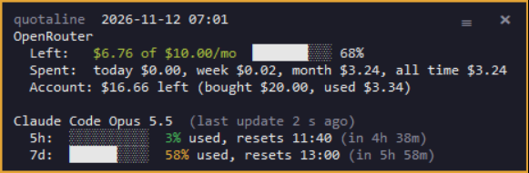

# quotaline

A tiny balance and quota counter for **Claude Code** and **OpenRouter**. One Python file, no
dependencies, the same on Windows, Linux and macOS. Show both, or only one of them: you do not
need an OpenRouter key to use the Claude part, nor Claude Code to use the OpenRouter part.

```
Claude Fable 5.1: ctx 23%, 5h 16% (10:08), 7d 34% (Tue 16:11)  |  OpenRouter: $8.09 left of $10/mo
```

That is the Claude Code status line. The same script also runs as a small window, a floating
widget or a tray icon. The widget, on Windows 11:



The same report in a terminal (`--watch`, or a one-shot run):

```
quotaline  2026-11-08 08:38
OpenRouter
  Left:   $8.09 of $10.00/mo  ████████░░ 81%
  Spent:  today $0.00, week $1.91, month $1.91, all time $1.91
  :free models today: 0 of 1000 requests

Claude Code  (last update 2 min ago, Fable 5.1)
  5h:  ██░░░░░░░░  19% used, resets 13:10
  7d:  ████░░░░░░  35% used, resets Thu 13:00
```

## Why

Tools like `ccusage` and `ccstatusline` do more, but they need Node and know nothing about
OpenRouter. OpenRouter credit monitors are mostly macOS menu-bar apps or editor plugins. I wanted
one line with both numbers that runs on an old Linux laptop as well as on Windows, without
installing a runtime or handing my credentials to anything. This is it.

## What it shows and where the data comes from

| Source | Data | How |
|---|---|---|
| OpenRouter | What is left of the key's spending limit, spend today / this week / this month / all time, today's requests to `:free` models | `GET https://openrouter.ai/api/v1/key` with your normal API key (documented) |
| OpenRouter | Account-wide balance (optional) | `GET /api/v1/credits`, which needs a separate **management key**; shown only if `openrouter_management_key.txt` exists |
| OpenRouter | Spend per day and model, last 30 completed UTC days, all keys of the account (`--days`, optional) | `GET /api/v1/activity` with the same management key (documented) |
| Claude Code | 5-hour and 7-day plan limits: % used and reset time | Claude Code hands them to the status line itself (`rate_limits`, documented, v2.1.251+). The script caches them in `~/.cache/quotaline/claude.json` so the other modes can show them outside Claude Code, with their age |

Reset times come with a countdown (`13:10, 2h36m`). Claude's limits appear after the first reply of each session. That is documented behaviour, not
a bug. Colours everywhere follow a continuous green → yellow → red gradient by percentage used, anchored at a clear yellow for 50 % and an unmistakable red for 80 %: the status line text, the report, the widget's text and border, and the tray dot (the dot and the border show the worst of what is displayed). Terminals without 24-bit colour get three plain steps instead; set `QUOTALINE_TRUECOLOR=1` or `0` to force either.

## Where you can see it

| Mode | Command | Needs |
|---|---|---|
| Claude Code status line | `--statusline` (set up by `--install-statusline`) | Claude Code 2.1.251+ |
| Terminal window that refreshes | `--watch` | nothing |
| Floating widget: small always-on-top panel, draggable; × closes (or Escape), ≡ unfolds a row of buttons inside the panel (Refresh, Both / Claude / OpenRouter, opacity, text size, Quit); while it refreshes a small spinner and a whimsical verb ("Tallying…", "Abacusing…") show up. Right-click gives the same as a popup menu, except on macOS, where Tk's popup menus leave the window deaf, so there it unfolds the row too. On macOS the panel keeps the native title bar (Tk there ignores clicks on bare windows) | `--widget` | tkinter (ships with Python on Windows and macOS; `sudo apt install python3-tk` on Debian/Ubuntu/Mint) |
| Tray / menu-bar icon: coloured dot, numbers in its menu and hover text, "Open widget" on click | `--tray` | `pip install pystray pillow`; on Linux also the desktop's bindings, e.g. `sudo apt install python3-gi gir1.2-ayatanaappindicator3-0.1` |

The tray is the only mode with extra packages. On Windows 11 new tray icons start in the hidden
overflow (the `^` chevron); the Windows installer pins quotaline's icon to the visible corner for
you, and you can always drag it in or out. Hover for the numbers, right-click for the menu,
left-click opens the widget. `--tray --open-widget` starts both at once (handy for a launcher).
Quit in the tray menu closes the widgets it opened as well; × on the widget closes only the widget.
Only one tray and one widget run at a time: starting the tray again just opens the widget, and a
second widget does not open over the first. On macOS the same mode puts the icon in the menu bar (UI updates are marshalled to the main thread, as AppKit requires). The widget and the
tray refresh every 60 s (`--interval SEC` to change it).

## Install

Requirements: Python 3.8+ and, for the status line, Claude Code 2.1.251 or later.

```bash
git clone https://github.com/<you>/quotaline
cd quotaline
```

Give it your OpenRouter key in one of these ways (first match wins). Skip this if you only want
Claude.

1. environment variable `OPENROUTER_API_KEY`;
2. a file `openrouter_key.txt` next to `quotaline.py` or in the parent folder (just the key);
3. nothing, if OpenCode is logged in to OpenRouter: the key is read from OpenCode's `auth.json`.

Then run the installer for your system. Each one asks three questions: what to show
(`both`, `claude`, `openrouter`), which launcher you want (`tray+widget`, `window`, `widget`,
`tray`, `none`; macOS has no `window`) and whether it should start with your session. The answers
can also be given as arguments. `tray+widget`, the default everywhere, starts the tray icon plus
the widget: on Windows and Linux the widget alone has no taskbar entry, since it has no title bar.
If `pystray` and `pillow` cannot be installed, `tray+widget` falls back to the widget alone.

- **Windows:** `powershell -ExecutionPolicy Bypass -File install_windows.ps1`
  Creates `quotaline.lnk` (here and on the Desktop) with the folder icon; with autostart, a copy in
  the Startup folder.
- **Linux:** `bash install_linux.sh`
  Sets the folder icon, writes `quotaline.desktop` to the Desktop and the applications menu; with
  autostart, a copy in `~/.config/autostart`. Where `pip install --user` is refused (Debian 12+,
  Ubuntu 23.04+, Mint 22+: PEP 668), the tray's packages go into a virtualenv in
  `~/.local/share/quotaline/venv` that still sees the system's `python3-gi` and `python3-tk`; that
  needs `sudo apt install python3-venv`.
- **macOS:** `bash install_macos.sh`
  Writes `quotaline.command` on the Desktop; with autostart, a launchd agent. **Tk 8.6.12 and
  older ignore mouse clicks on macOS 14 and later** ([CPython issue 110218](https://github.com/python/cpython/issues/110218)),
  so the installer picks a `python3` whose Tk is 8.6.13 or newer: python.org 3.11.7+ / 3.12+, or
  Homebrew's `brew install python-tk@3.14`. With Homebrew's Python it creates a small virtualenv in
  `~/.local/share/quotaline/venv` for `pystray`, because that Python refuses `pip install` otherwise.
  python.org builds ship without root certificates until you run their "Install Certificates.command";
  the installer adds `certifi` in that case and quotaline uses it. Tested on macOS 27 (Apple silicon).

All of them configure the Claude Code status line if `claude` is installed, and save your
"what to show" choice in `~/.config/quotaline/config.json` so every mode uses it.

By hand instead: `python3 quotaline.py --show claude --save`, `python3 quotaline.py --install-statusline`,
then `python3 quotaline.py --widget` or `--tray` or `--watch` from any launcher you like.

`--install-statusline` writes a `statusLine` block into `~/.claude/settings.json` (a backup
`settings.json.bak-quotaline-<date>` is made first). `--uninstall-statusline` removes it.

## Usage

```
quotaline.py                        one-shot report
quotaline.py --watch                refreshing counter in the terminal
quotaline.py --widget               floating always-on-top panel
quotaline.py --tray                 tray / menu-bar icon (--open-widget: the widget too)
quotaline.py --statusline           Claude Code status line mode (JSON on stdin)
quotaline.py --json                 same data as JSON
quotaline.py --days [N]             OpenRouter spend per day and model, last N completed days (30)
quotaline.py --install-statusline / --uninstall-statusline

  --show both|claude|openrouter   what to display (default: the saved choice, else both)
  --save                          save --show, --opacity and/or --font-size as the default
  In the widget (≡ row or right-click > Show) and in the tray menu (Show) the
  Both / Claude / OpenRouter choice can be changed on the fly; it is saved as the new default.
  --interval SEC                  refresh period for --watch / --widget / --tray (60)
  --opacity 0.2-1                 widget opacity (default 0.95); also from the widget's menu
  --font-size 7-24                widget text size; also A- / A+ in the widget's menu or Ctrl + / Ctrl -
  --no-color
```

`--days` answers "what did I spend yesterday, and on which model?" (here `--days 2`):

```
OpenRouter spend per day  (UTC days, all keys of the account; today is not included)
  Mon 2026-11-09   $0.0217     16 req  ░░░░░░░░░░
                   $0.0215     14 req  deepseek/deepseek-v4.1-flash-1017
                   $0.0001      2 req  openai/gpt-6-luna
  Sun 2026-11-08   $1.3121    505 req  ██████████
                   $1.3120    504 req  deepseek/deepseek-v4.1-flash-1017
                   $0.0000      1 req  openai/gpt-6-luna
  Total            $1.3337    521 req  active days: 2 of 2
```

Days are UTC days, as OpenRouter counts them, and only finished ones: today's spend is the
"today" figure of the normal report. `--days 1` shows only yesterday, `--days 7` the last week.

The status line refreshes every 30 s; OpenRouter is asked at most once every 5 minutes (cache in
`~/.cache/quotaline/openrouter.json`). If the network is down, the last known values are shown with
their age. The status line always refreshes the Claude cache, even with `--show openrouter`, so
the widget and the tray can show Claude's limits while Claude Code is open.

## Privacy

- The key is never printed. If the key has no name on OpenRouter, the API returns the masked key
  as its label; that is not shown either.
- No Claude credentials are read and no undocumented Anthropic endpoint is called. Outside Claude
  Code the script only shows what the status line last saved.
- Nothing leaves your machine except the documented OpenRouter requests listed above.

## Limitations

- Claude's limits outside Claude Code are as fresh as the last status-line refresh: if Claude
  Code is closed, the widget shows the last known values with their age.
- Per-session OpenCode spend is not counted (OpenCode shows that itself).
- The dollar cost Claude Code estimates for a session is not shown: on a subscription it means
  nothing.
- Only ASCII separators are used in the status line on purpose: box-drawing and arrow glyphs
  render badly in some terminal fonts.

## Ideas

- **Codex CLI** as a third source, next to Claude Code and OpenRouter. Not done yet because Codex
  does not publish its limits through a documented interface; the tools that show them read its
  local logs or an internal endpoint that changes between releases, which is exactly what this
  project avoids for the other two. If an official way appears, or you want it anyway, open an issue.

## Icon

`_icon_source.py` (Pillow) generates `_icon.ico` and `_icon.png`: a violet badge with a gauge.
The `.ico` is for the Windows folder (via a local `desktop.ini`, not tracked) and the shortcuts,
the `.png` for Linux file managers and launchers.

## License

MIT.
